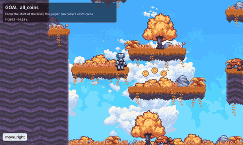
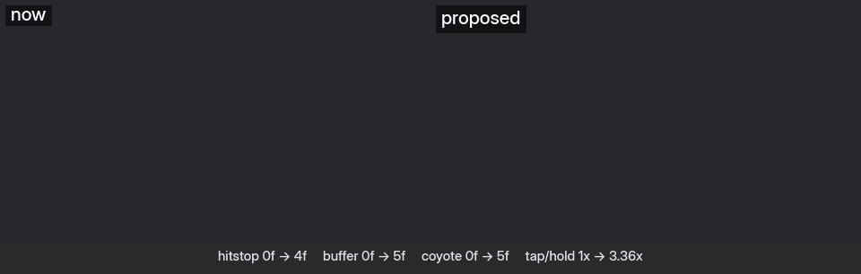
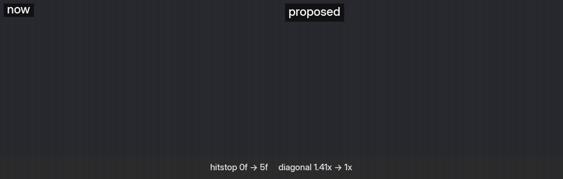
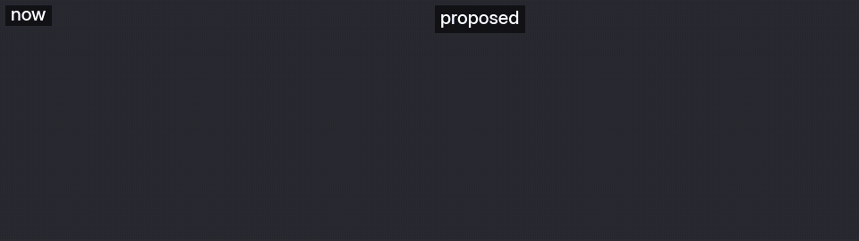
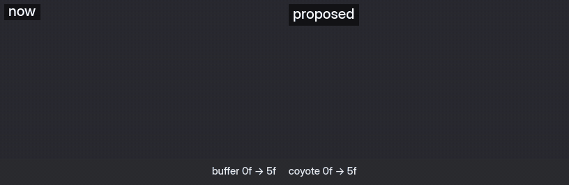
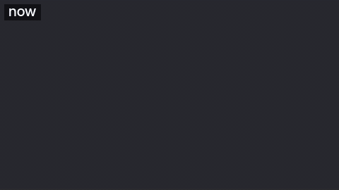

# Ghostlap

**Claude playtests your Godot game, proves what works, and leaves a ghost: a replay test that
keeps proving it.**



*Claude playing Godot's official [2D platformer demo](https://github.com/godotengine/godot-demo-projects/tree/master/2d/platformer)
(MIT) from a cold start, with the goal "collect all 21 coins". It read the frozen game as text,
found the two elevators in the level file, and used 87 of its 120 commands. `play end` accepted
the pass because the coin counter reached 21, then replayed all 3,382 frames identically and
rendered this captioned video. The GIF is the last 11 seconds.*

> **Status: in development.** The playtester (`ghostlap play`) works end to end on the
> `phase-1` branch: Claude drives your real levels frame by frame and rules pass / fail / blocked
> with evidence. `play end` checks that ruling, replays the run to confirm it, and renders the
> video. Saving the run as a CI test comes next. What ships today on `main` is the
> **game-feel toolkit**, `ghostlap feel`, described below.

## Playtester (`ghostlap play`, phase-1 branch)

```bash
ghostlap scan && ghostlap detect && ghostlap play preflight   # what the game is; will it replay?
ghostlap play start .ghostlap/goals/all_coins.yaml            # the game starts frozen at frame 0
ghostlap play until "player.global_position.x > 770" --hold move_right --press jump@1:20
ghostlap play look --view player,near,map                     # the frozen game as compact text
ghostlap play rewind --to 2755                                # try again from an earlier frame
ghostlap play end --verdict pass --why "…" --video             # checked, replayed, report + video
```

The `playtest` skill in `plugin/skills/playtest/` teaches Claude the loop:
1. understand the game;
2. write a goal with a machine check;
3. plan the route;
4. play;
5. rule pass, fail or blocked;
6. report.

## Game feel toolkit (`ghostlap feel`)

ghostlap reads an unfamiliar Godot project, works out what kind of game it is, runs scripted
micro-tests headless, and tells you, and your AI agent, *how it feels* in numbers, with
concrete fixes it verifies before you apply them:



*The floaty example platformer replaying identical inputs: as it is ("now") and with ghostlap's
verified proposal. Its floaty movement is kept; ghostlap adds coyote time, a jump buffer,
short hops on tapped jumps and hitstop. More examples [below](#examples).*

```
### ❌ jump.coyote_frames = 0 frames (good: 4–8) — unforgiving ledges
- Set `coyote_time` 0 → 0.087 (res://player.gd:10) → ≈5 frames at 60 fps

### ❌ jump.variable = 1 x (good: 1.5–4) — no jump-height control
- Set `jump_cut` 1 → 0.5 (res://player.gd:15): short taps give lower jumps
```

It's built to be driven by an AI coding agent (a Claude Code skill is included), but works
fine by hand.

> **Status: v1 (early).** The reference ranges are **uncalibrated placeholders**. They're
> reasonable starting points, not measured from reference games yet (see
> [docs/calibration.md](docs/calibration.md)). Treat findings as "worth a look", not verdicts.

## What it does

1. **Understands the project.** `ghostlap scan` builds a graph of scenes, scripts, signals,
   exported properties and input actions in `.ghostlap/graph.db` (SQLite). It uses Godot itself
   as the parser (headless, reading scenes without running them), with a text fallback for
   projects that don't load. Rescans are incremental.
2. **Detects what the game is.** `ghostlap detect` finds the player, maps input actions to
   roles, scores genre packs with evidence (`applies gravity: velocity.y += g * delta
   (res://player.gd:27)`), and lists mechanics, levels and hazards. You confirm or correct it.
3. **Measures feel.** `ghostlap feel check` builds small test arenas (or uses your levels), drives
   the player with frame-exact inputs at a fixed frame rate, records every physics frame, and
   computes metrics: jump arc, coyote time, input buffering, acceleration, stopping, turning,
   dash, attack startup, hitstop, knockback, camera follow and more (`ghostlap feel metrics`).
4. **Suggests fixes.** Findings point at the exact property (file:line, current → proposed),
   using simple physics models where they exist (a jump keeps its height while its timing
   changes). Findings that share a cause are grouped and get one shared value.
5. **Verifies them instead of trusting them.** `ghostlap feel propose` applies the suggestions to a
   scratch copy, re-measures, and repeats until clean. Each value moves at most 2× per pass and
   coupled values move together. You get the measured before → after, regressions and prediction
   errors; your project is untouched until `ghostlap feel apply`.
6. **Shows you.** `ghostlap feel clip` renders "now" vs "proposed" with identical inputs as a GIF/MP4
   (plus a contact sheet an agent can read). A clean report isn't proof that it feels right;
   watching is.
7. **Listens.** `ghostlap feel feedback "falls too fast"` turns your words into this project's ranges,
   so the next proposal moves toward what you want.

**Forgiveness first, motion is your call.** Coyote time, jump buffering, variable jump height,
hitstop, invulnerability, hit feedback, input latency and diagonal speed help almost every game,
so ghostlap fixes those. *How the character moves* (acceleration, stopping, jump timing, fall
speed) is style: floaty, momentum-heavy movement is a valid choice and often reads as more
game-like than snappy movement. ghostlap describes it but only changes it if you ask
(`tune: all` in `profile.yaml`, or `ghostlap feel propose --scope all`).

## Quick start

Requirements: Python 3.10+, Godot 4.3+ (`godot` on PATH, or `GHOSTLAP_GODOT=/path/to/godot`).

```bash
# not on PyPI yet: install from a checkout
git clone https://github.com/Bollesh/ghostlap && uv tool install ./ghostlap   # or: pip install ./ghostlap

cd your-godot-project
ghostlap scan          # build the graph (first run imports the project)
ghostlap detect        # what is this game? writes a draft .ghostlap/profile.yaml
#   review/edit .ghostlap/profile.yaml, then:
ghostlap confirm
ghostlap feel check         # run probes + analyze -> .ghostlap/report.md
ghostlap feel propose       # verify the fixes in a scratch copy -> .ghostlap/proposals/<stamp>/proposal.md
ghostlap feel clip          # watch now vs proposed side by side (needs ffmpeg and a display, or xvfb-run)
ghostlap feel feedback "the jump feels floaty"   # if something still feels off; then propose + clip again
ghostlap feel apply         # write the proposal's changes to your project
```

ghostlap only writes to `.ghostlap/` (plus Godot's own `.godot/` import cache). It runs its
GDScript from outside your project, so nothing needs installing into `addons/`.

## With Claude Code

This repo is also a Claude Code plugin marketplace. Install the skill in one step:

```
/plugin install ghostlap --marketplace Bollesh/ghostlap
```

or, on older Claude Code versions:

```
/plugin marketplace add Bollesh/ghostlap
/plugin install ghostlap@ghostlap
```

(The plugin itself lives in `plugin/`, so installs only fetch the skill. The same commands work
from your shell as `claude plugin ...`. Updates arrive through
`/plugin`; pin a release with `Bollesh/ghostlap#v0.1.0`.) The plugin ships the skill only;
install the `ghostlap` CLI as shown above.

Then ask something like *"why does my jump feel floaty?"* or *"check the game feel"*. The skill
scans, confirms the genre and player with you, asks what to test, writes game-specific probes
if needed, and applies fixes only after you approve them.

## Genre packs (v1)

| pack | for | example probes |
|---|---|---|
| `platformer` | side view with gravity and jump | jump tap/hold, coyote, jump buffer |
| `action_sidescroller` | platformer + attacks | attack startup/active/recovery, combo window |
| `topdown` | free 2D movement, no gravity | diagonal speed, dash, dash cooldown |
| `third_person_3d` | CharacterBody3D (incl. 2.5D) | camera follow, turn-to-face, 30° slope |
| `core` (included by all) | any controlled character | run/stop, turnaround, input latency, getting hit |

Puzzle packs (tile-matching, block-pushing, logic grids, physics puzzles) are planned for
v1.x. Packs are plain YAML, so you can write your own: see [docs/packs.md](docs/packs.md).

## Examples

Each example replays identical inputs. Left is the game as it is; right is ghostlap's verified
proposal (forgiveness and feedback only; motion untouched).

| | |
|---|---|
| **platformer_floaty**: coyote time, jump buffer, short hops, hitstop |  |
| **topdown_sluggish**: normalized diagonals, dash cooldown, hitstop |  |
| **action_basic**: a combo window |  |
| **third_person_basic** (3D): coyote time, jump buffer |  |
| **platformer_tuned**: the floaty platformer with forgiveness and hit feedback built in (nothing to propose) |  |
| **topdown_tuned**: smooth movement, normalized diagonals, hit feedback (nothing to propose) |  |

The probe arenas are deliberately plain: grey floor, markings every two body heights, and a
camera that follows sideways at a fixed height so jump arcs stay readable.

## Writing a probe

```yaml
# .ghostlap/probes/dash_into_wall.yaml
probe: dash_into_wall
requires: {actions: [right, dash]}
arena: wall                 # or: scene: {path: res://levels/l2.tscn, spawn: SpawnPoints/A}
frames: 90
inputs:
  - {at: 0, action: right, hold: 60}
  - {at: 20, action: dash, hold: 1}
measure: [dash.distance, impact.knockback]
assert: {dash.distance: {max: 6}}
```

`ghostlap feel probe validate <file>` checks it; `ghostlap feel check` picks it up automatically.

## Commands

| command | |
|---|---|
| `scan [--full] [--text-only]` | build/update the graph |
| `detect [--write-profile]` | detect player, actions, genres, mechanics |
| `confirm` | mark the profile confirmed |
| `graph profile` / `graph query NAME …` / `graph sql "…"` | query the graph (`who-reads`, `exports-of`, `script-of`, `instanced-by`, `scenes-with`, `node`, `path`, `search`) |
| `feel probe list` / `feel probe validate FILE…` / `feel probe run [--only …]` | probes |
| `feel analyze [--run DIR]` / `feel check` | report / run + report |
| `feel propose [--scope forgiveness\|all] [--passes N] [--cap X]` | verify fixes in a scratch copy, until clean |
| `feel clip [--against proposal\|NAME] [--alone] [--save-as NAME] [--probes …]` | render side-by-side GIF/MP4 + contact sheet |
| `feel feedback "words"` / `feel feedback --metric M --direction high\|low` | record how it feels; tightens this project's ranges |
| `feel apply [--proposal STAMP] [--only PROP…]` | write a verified proposal to the project |
| `feel metrics`, `feel packs`, `feel pattern NAME`, `doctor`, `init` | reference & environment |

Every command accepts `--project DIR` and `--json`.

## How it works

- `addons/ghostlap/scan/scan.gd`: headless extractor (SceneState, script reflection,
  InputMap, ProjectSettings).
- `addons/ghostlap/probe/`: probe runner, test arenas and per-frame sampler. Inputs are
  applied at the end of the previous physics tick, so `is_action_just_pressed()` is true on
  exactly the scheduled frame.
- `cli/src/ghostlap/`: graph store, incremental change detection (mtime → hash → uid
  renames), detection, probe compiler, metrics, analysis and suggestions.

## Known limits (v1)

- Mechanical feel only. Whether the game is *fun* is still a human call.
- Probes instance the player into generated arenas. Players that need their level (siblings,
  autoload state) may need a `scene:` probe pointing at a real level.
- RigidBody players have no `is_on_floor()`, so coyote/buffer probes can't measure them.
- `jump.buffer_frames` can read 1 frame high for games that check `is_on_floor()` after
  `move_and_slide()`.
- Camera shake is detected through `Camera2D.offset` / `Camera3D` h/v offsets only.
- Headless timing (`perf.frame_spikes`) excludes rendering.
- C# scripts are understood only through the engine scan of a built project.

## Development

When releasing, bump the version in `pyproject.toml`, `cli/src/ghostlap/__init__.py`,
`plugin/.claude-plugin/plugin.json` and `addons/ghostlap/plugin.cfg` together; a test fails if they differ.

```bash
uv sync
uv run pytest            # end-to-end tests run when Godot is available
uv run ghostlap --help
```

The `examples/` folder has one deliberately-off and one tuned project per pack. The test
suite asserts the off ones get their expected findings, the tuned ones come back clean, and
applying the report's own suggestions to the floaty platformer converges to clean.

## License

MIT
